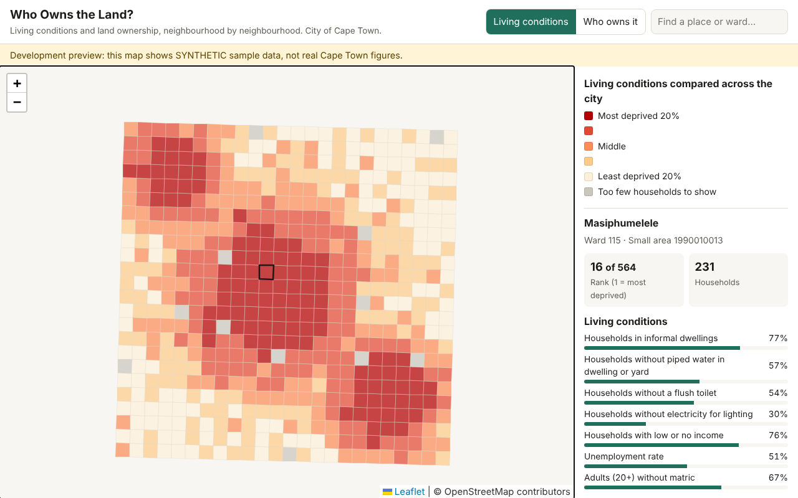

<div align="center">

# Who Owns the Land?

**Clear, neutral, neighbourhood-level facts about land ownership and living conditions in South Africa, starting with the City of Cape Town.**

[](https://github.com/liandusmarty-debug/who-owns-the-land/actions/workflows/ci.yml)
[](LICENSE)
[](LICENSE-DATA.md)
[](PRIVACY.md)

[**View the live map →**](https://liandusmarty-debug.github.io/who-owns-the-land/)
&nbsp;·&nbsp; [How it works](#how-the-living-conditions-score-works)
&nbsp;·&nbsp; [Data sources](#data-sources)
&nbsp;·&nbsp; [Run it yourself](#for-developers)



<sub>Preview built from <strong>synthetic sample data</strong>. These are not real Cape Town figures.</sub>

</div>

---

## Why this exists

South Africa has a lot of land, and a lot of strong opinions about it. What's usually missing is
plain information about specific places: **who owns the land in a given neighbourhood, how people
there are living, and what could realistically be done with it.**

The facts exist, but they're scattered across census tables, municipal valuation rolls, cadastral
maps and deeds records. Each is in a different format and most are hard for an ordinary citizen to
use. *Who Owns the Land?* is a non-profit project that brings those sources together, links them
place by place, and presents the result in a form anyone can read.

We don't take sides. The goal is a shared, checkable picture of where the country actually stands,
so that conversations about land, housing and development can start from the same facts.

> **Pilot:** the first in-depth case study is **Masiphumelele**, supporting a community housing pilot in Cape Town's far south.

## What you can find out

Pick any neighbourhood on the map to see:

- **Living conditions:** how it compares with the rest of the city on housing, water, sanitation,
  electricity, income, employment and education.
- **Who owns the land:** how much of the area belongs to the City, the Province, National
  government, private owners or others, and how much isn't mapped at all.
- **Where it ranks:** its position from most to least deprived across the city, and which fifth
  of the city it falls into.

There's also a downloadable table of every small area, a written city summary, and one-page
profiles for priority areas.

## Using the map

| You want to… | Do this |
|---|---|
| See which areas are worst off | Choose **Living conditions**. Darker red means more deprived. |
| See who owns the land | Choose **Who owns it**. Each colour is the main owner type. |
| Find a place | Type a settlement or ward name in the search box. |
| See an area's details | Tap the area. Its profile opens in the side panel (below the map on phones). |
| Understand the limits | Open **About this data** at the bottom of the panel. |

Grey areas have too few households to show figures safely (see [Privacy](#privacy-first)).

## How the living-conditions score works

Each Census 2022 *small area* (usually a few city blocks) is scored on seven indicators:

| Indicator | Measured as |
|---|---|
| Informal dwellings | % of households |
| No piped water in dwelling or yard | % of households |
| No flush toilet | % of households |
| No electricity for lighting | % of households |
| Low or no household income | % of households |
| Unemployment | % of the labour force |
| No matric | % of adults aged 20+ |

1. Each indicator is put on a common scale (z-score by default, or min-max).
2. The indicators are averaged into one score. Weights are **equal by default** and can be changed in
   [`config/pipeline.toml`](config/pipeline.toml).
3. Areas are **ranked** (1 = most deprived) and split into **five equal groups**, from least to most deprived.

The score is **relative**: it compares areas within the city, not against a fixed national standard.

## Data sources

| Source | What it provides |
|---|---|
| Stats SA, Census 2022 small-area layer | Population, households, dwellings, services, income, employment, education |
| Stats SA / Municipal Demarcation Board | Small-area boundaries |
| City of Cape Town Open Data Portal | Wards, informal settlements, zoning, land parcels, valuation roll (owner type) |
| Surveyor-General (Cape Town) | Cadastral (erf) boundaries |
| Deeds Office *(optional, priority areas only)* | Parcel ownership, published by **owner type only** |

Every dataset's publisher, licence, retrieval date and file checksum is logged automatically in
[`sources.md`](sources.md) each time the data is rebuilt.

## Privacy first

This project describes **places, not people**, in line with South Africa's Protection of Personal
Information Act (POPIA). These rules are enforced in code, not just written down:

- 🔒 **No names.** Registered-owner names are turned into an owner *type* (City, Province, National,
  Private or Other) and then discarded. They never reach any output.
- 🔒 **No small numbers.** Areas with fewer than 30 households have their figures hidden and are not ranked.
- 🔒 **Checked twice.** The pipeline refuses to write a file that contains a personal-data field,
  and automated checks scan every published file again before it goes live.
- 🔒 **No raw data in this repository.** Everything is rebuilt from its original public source.

Think something could identify a person? See [PRIVACY.md](PRIVACY.md) to report it privately.

## Built to run on almost anything

Many people will open this on an entry-level phone with expensive data, so it's built for that:

- **No app, no login, no server.** The site is a handful of static files.
- **Small:** the whole sample site is about 350 KB before compression, and the map data is pre-simplified.
- **Fast on cheap phones:** neighbourhoods are drawn on a single canvas, not thousands of page elements.
- **Works offline:** copy the folder to a USB stick or a community centre PC and open `map.html`.
- **Comfortable to use:** works on phones and desktops, follows the device's dark mode, and uses no web fonts.

## For developers

### Quick start

Requires [uv](https://docs.astral.sh/uv/) (which installs Python 3.11+ for you).

```bash
git clone https://github.com/liandusmarty-debug/who-owns-the-land.git
cd who-owns-the-land
make setup      # install pinned dependencies
make sample     # build everything from a synthetic city → outputs/_sample/
make test
```

Open `outputs/_sample/map.html` in a browser. No server is needed.

### Building from real data

Place each source in `data/raw/<source-id>/` (IDs and download notes are in
[`config/pipeline.toml`](config/pipeline.toml)), then:

```bash
make build      # one command rebuilds every output from raw data → outputs/
```

### What gets produced

| Output | Description |
|---|---|
| `neighbourhood_profiles.csv` | One row per small area: indicators, score, rank, group, ownership mix |
| `map.html` / `index.html` | The interactive map. The whole `outputs/` folder is the website. |
| `summary.md` | The 20 most deprived areas, ownership breakdown, method and caveats |
| `profile_masiphumelele.md` | One-page pilot profile |
| `sources.md` | Provenance log for every dataset |

### How it's built

A small object-oriented pipeline in Python (geopandas, shapely, pyproj). Each stage is one class
with one job:

```
Ingest → Clean → Join → Deprivation index → Ownership overlay → Reports → Web map
```

Every tunable setting (indicator weights, thresholds, owner-type rules, coordinate systems and
sources) lives in one file, `config/pipeline.toml`. Full design notes are in
[docs/ARCHITECTURE.md](docs/ARCHITECTURE.md).

```
config/pipeline.toml   settings and declared data sources
src/wotl/              the pipeline, one module per stage
web/                   the static front end (vanilla JS + vendored Leaflet)
tests/                 unit tests and an end-to-end synthetic build
docs/                  architecture and design notes
data/, outputs/        git-ignored, always rebuilt from sources
```

## Known limitations

- Census 2022 undercounted some populations, especially in informal settlements, so conditions
  there may be worse than the figures show.
- Official cadastral and valuation records don't capture informal occupation or customary rights.
- Small areas have small populations, so some figures are suppressed and individual rates can be noisy.
- The score ranks areas against each other. It doesn't measure poverty on an absolute scale.

## Roadmap

- [x] Reproducible pipeline, privacy guard-rails and a lightweight map (synthetic preview)
- [ ] Confirm source licences and ingest real Census 2022 and City of Cape Town data
- [ ] Publish the first real city-wide ranking and the Masiphumelele profile
- [ ] Plain-language explainers and isiXhosa / Afrikaans translations
- [ ] Shareable links and printable profiles for each area
- [ ] What owners can do with the land: zoning and development rights per area
- [ ] Extend beyond Cape Town to other municipalities

## Get involved

We welcome help from data people, developers, translators, researchers and community members.
Read [CONTRIBUTING.md](CONTRIBUTING.md) to get started, and please follow our
[Code of Conduct](CODE_OF_CONDUCT.md). Spotted a figure that looks wrong, or know a dataset we
should use? [Open a data issue](https://github.com/liandusmarty-debug/who-owns-the-land/issues/new/choose).

## Licence and citation

- **Code:** [MIT](LICENSE). Free to use, adapt and share.
- **Published data:** [CC BY 4.0](LICENSE-DATA.md). Free to reuse with credit to *Who Owns the Land?*
- **Third-party sources** keep their own terms, recorded in [`sources.md`](sources.md).

To cite this work, use the details in [`CITATION.cff`](CITATION.cff), or click **"Cite this repository"** on GitHub.

---

<div align="center">
<sub>A non-profit project for clarity on land in South Africa. Facts first, area-level only.</sub>
</div>
